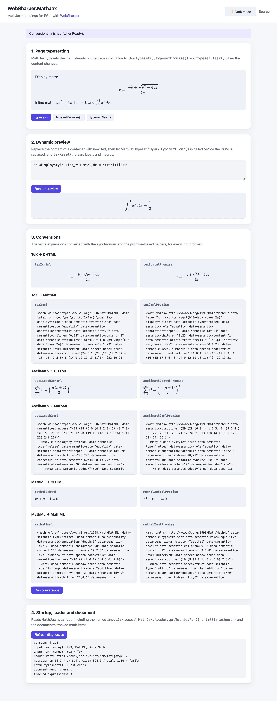

# WebSharper.MathJax

[](https://www.nuget.org/packages/WebSharper.MathJax)

WebSharper bindings for [MathJax 4.x](https://www.mathjax.org/) (4.1.3+), the
JavaScript display engine for TeX, MathML and AsciiMath.

MathJax can render static math found on a page, and it exposes an API for
typesetting dynamically generated content and for converting individual
expressions between input and output formats. This package binds that API for
F# and C# WebSharper applications, including the `MathJax.startup`,
`MathJax.loader` and `MathJax.startup.document` objects and the promise-based
conversion helpers introduced in MathJax v4.

This repository contains:

| Project | Purpose |
| --- | --- |
| `WebSharper.MathJax` | The WIG binding: the `MathJax` global and its types (`MathDocument`, `MathItem`, `InputJax`, `OutputJax`, `DOMAdaptor`, `Menu`, `Loader`, …), the configuration types (`TeXInputConfig`, `ChtmlConfig`, `SvgConfig`, `MathJaxStartupConfig`, `MathJaxLoaderConfig`, …) and the AssemblyWide resource that loads the MathJax component. |
| `WebSharper.MathJax.ConfigResource` | A WebSharper resource that emits the `MathJax = { … }` configuration before the component script. Used by server-side (Sitelets) applications, where the configuration comes from `appsettings.json`. |
| `WebSharper.MathJax.Sample` | A static WebSharper SPA (esbuild → `dist/`) that exercises the whole surface: page typesetting, dynamic typesetting, all conversions in both sync and promise form, and the startup/loader/document APIs. |
| `WebSharper.MathJax.Sitelets` | A Sitelets sample that shows the `mathjaxConfig` setting injected before the component. |

## Live demos

**Try it live:** [Open the sample in your browser](https://dotnet-websharper.github.io/mathjax/)



The sample doubles as the binding's [test case](#running-the-test-case): it
typesets static and dynamic content, clears and re-typesets the page, converts
TeX/AsciiMath/MathML to CHTML and MathML (synchronously and via promises), and
reads `MathJax.startup` (named `inputJax` access), `MathJax.loader`,
`getMetricsFor()`, `chtmlStylesheet()` and the document's tracked math items. It
is light-themed by default and has a light/dark theme switcher (persisted in
`localStorage`).

- **Sample (this repository):** <https://dotnet-websharper.github.io/mathjax/>
- **Source repository:** <https://github.com/dotnet-websharper/mathjax>
- **WebSharper bindings:** <https://websharper.com/bindings>

## Install

```bash
dotnet add package WebSharper.MathJax
```

Or with Paket:

```fsharp
nuget WebSharper.MathJax
```

The package targets `netstandard2.0` and works with WebSharper 10 and 11
projects. It supports MathJax `>= 4.1.3 < 5.0.0`.

## How MathJax is loaded

MathJax must be **configured before it loads**, so the binding links the
combined component from the npm package on jsDelivr as an AssemblyWide resource:

```html
<script src="https://cdn.jsdelivr.net/npm/mathjax@4.1.3/tex-mml-chtml.js"></script>
```

WebSharper emits this tag into the page head (in a static SPA it ends up in the
generated `*.head.html`). The `WebSharper.MathJax.ConfigResource` dependency is
rendered *before* it, so server-side applications can inject the configuration
from settings.

> **Note.** This binding deliberately keeps the page-global `MathJax` object
> (the way MathJax's component files are distributed) rather than importing the
> library as an ES module: the component has to run after the `MathJax = { … }`
> configuration and before your application code. The npm package version is
> pinned in the resource URL, and the v4 component paths have no `es5/`
> directory any more.

## Configuring MathJax

### SPA projects

Put the configuration in a `<script>` in the page head, **before** the
WebSharper head resources:

```html
<script>
    MathJax = {
        loader: {
            // tex-mml-chtml does not include AsciiMath
            load: ['input/asciimath']
        },
        tex: {
            // In v4, `[+]` *adds* delimiters to the defaults instead of
            // replacing them.
            inlineMath: { '[+]': [['$', '$']] }
        },
        chtml: {
            matchFontHeight: true
        },
        options: {
            enableMenu: true
        }
    };
</script>
<!-- ws-head -->
```

### Sitelets projects

Put the same configuration (as a string) in `appsettings.json`; the
`ConfigResource` injects it before the component:

```json
{
  "websharper": {
    "mathjaxConfig": "MathJax = { \"loader\": { \"load\": [\"input/asciimath\"] }, \"tex\": { \"inlineMath\": { \"[+]\": [[\"$\",\"$\"]] } } }"
  }
}
```

### Input and output formats

| Format    | Input component  | Bound helpers |
|-----------|------------------|---------------|
| TeX       | `input/tex`      | `tex2chtml`, `tex2svg`, `tex2mml` (+ `…Promise`) |
| MathML    | `input/mml`      | `mathml2chtml`, `mathml2svg`, `mathml2mml` (+ `…Promise`) |
| AsciiMath | `input/asciimath`| `asciimath2chtml`, `asciimath2svg`, `asciimath2mml` (+ `…Promise`) |

| Format | Output component | Stylesheet |
|--------|------------------|------------|
| CHTML  | `output/chtml`   | `MathJax.ChtmlStylesheet()` |
| SVG    | `output/svg`     | `MathJax.SvgStylesheet()` |

The conversion helper names correspond to the **configured** input/output
components (MathJax generates them at startup): with the default
`tex-mml-chtml` component you get the `…2chtml` and `…2mml` helpers. To use the
`…2svg` helpers, configure `output/svg` instead and load the `tex-mml-svg`
component (`MathJax.SvgStylesheet()` is only generated then).

## Usage

All types live in the `WebSharper.MathJax` namespace.

### Typeset the page

```fsharp
open WebSharper.MathJax

// Typeset everything currently on the page (synchronous).
MathJax.Typeset()

// Prefer the promise-based call in v4: it waits for font data and extensions.
MathJax.TypesetPromise().Then(fun () ->
    printfn "typeset complete")
|> ignore
```

`Typeset` only works while no font data or extensions need to be fetched; MathJax
v4 loads font data on demand, so `TypesetPromise` is the safer entry point.

### Typeset dynamically changing content

MathJax does not watch the DOM. Before replacing content that contains typeset
math, tell MathJax to forget it, then typeset the new content:

```fsharp
let container = JS.Document.GetElementById "preview"

MathJax.TypesetClear([| box container |])   // before changing the DOM
MathJax.TexReset()                          // reset labels, numbering and macros
container.InnerHTML <- source             // the new TeX, with delimiters
MathJax.TypesetPromise([| box container |])
    .Then(fun () -> status.Value <- "Typeset.")
|> ignore
```

`Typeset`/`TypesetPromise` accept an array of DOM elements or CSS selector
strings to restrict the work to those containers. `TypesetClear` accepts the
same, and `TypesetClear()` with no arguments forgets the whole page.

### Convert a single expression

```fsharp
// A DOM node (insert it, or read its OuterHTML)
let node = MathJax.Tex2chtml(@"\sqrt{x^2+1}")
parent.AppendChild(node) |> ignore

// Serialized MathML
let mml : string = MathJax.Tex2mml(@"\sqrt{x^2+1}")

// Promise-based, with conversion options (display/em/ex/containerWidth/scale)
MathJax.Tex2chtmlPromise(
    @"\frac{1}{2}",
    ConversionOptions(Display = false, Em = 16.0, Ex = 8.0)
).Then(fun node ->
    parent.AppendChild(node) |> ignore)
|> ignore
```

The same shape is available for AsciiMath and MathML, for CHTML and (when the
SVG output is configured) SVG. Note that a converted node is not tracked by
MathJax's document math list; prefer typesetting the source in place when you
want menu/accessibility updates to apply to it.

### Startup, loader and the document

```fsharp
// MathJax.startup
let doc = MathJax.Startup.Document
let texJax = MathJax.Startup.Input.Tex   // named access (v4)
let count = doc.GetMathItemsWithin([| box document.Body |]).Length

// Metrics and the CHTML stylesheet
let metrics = MathJax.GetMetricsFor(element, true)
let css = MathJax.Startup.Adaptor.CssText(MathJax.ChtmlStylesheet() |> As<Dom.Element>)

// MathJax.loader
MathJax.Loader.Load("input/asciimath").Then(fun _ -> ()) |> ignore
let root = MathJax.Loader.GetRoot()

// queue work after all pending MathJax operations (v4)
MathJax.WhenReady(fun () -> status.Value <- "done"; null) |> ignore
```

`MathJax.Done()` shuts down the web worker used for speech generation; call it
when the page is torn down. `MathJax.Startup.Document.Menu` is the contextual
menu (present with the combined components).

## Notes on the API

- **MathJax 4 or 3.** The binding targets MathJax 4.x. The 3.x branch of this
  repository (`websharper100`, and older releases) binds MathJax 3.2.2.
- **Promises serialize automatically.** In v4 the promise-based typeset and
  conversion calls are chained internally, so you no longer need to use
  `MathJax.startup.promise` to serialize them. `whenReady`/`document.whenReady`
  queue an action after the pending work instead.
- **New in v4, bound here:** `whenReady`, `done`, `MathDocument.renderPromise`,
  `rerenderPromise`, `convertPromise`, `whenReady`, `actionPromises`,
  `savePromise`, `clearPromises`, `done`, `DOMAdaptor.cssText`,
  `createWorker`, `getElement`, `setProperty`/`getProperty`, named `inputJax`
  access, the `…2svg` conversion helpers, `svgStylesheet`, the `Menu` object,
  the `Package`/`PackageConfig` loader types, the output-jax caches
  (`startup.output.clearCache()` for CHTML, `clearFontCache()` for SVG) and the
  `a11y/speech`-related `done()`.
- **Removed/altered in v4:** `Metrics.lineWidth` is gone (use
  `containerWidth`); `MathItem.setMetrics` takes four arguments; `LinkedList`'s
  `remove` returns the list; the loader's `preLoad` is now `preLoaded`; the v3
  TeX `digits` option is now `numberPattern`.
- **`Metrics`** now also carries `family` and `display` (from
  `getMetricsFor()`).
- `MathJax.Tex2mml`/`Mathml2mml`/`Asciimath2mml` return `string` (serialized
  MathML), while the CHTML/SVG helpers return `Dom.Node`.
- Configuration values that MathJax v4 treats as additive (`inlineMath`,
  `packages`, …) must use the `{ '[+]': … }` form; plain arrays replace the
  defaults.

## Running the test case

The sample is a static SPA. Build it in Release mode, then serve `dist/`:

```bash
dotnet tool install -g dotnet-serve   # once
dotnet build WebSharper.MathJax.Sample/WebSharper.MathJax.Sample.fsproj -c Release
dotnet serve -d dist -p 8080
```

Open <http://localhost:8080/>. The page requires network access to the jsDelivr
CDN for the MathJax component and its font files.

## Build from source

The repository uses [Paket](https://fsprojects.github.io/Paket/) and the
WebSharper build script.

```bash
dotnet tool restore
dotnet paket restore
dotnet build -c Release
```

You need the .NET 11 SDK (the WebSharper 11 compiler runs on .NET 11).

## Pack

```bash
WSPackageFolder=/tmp/pkg ./build WS-Package
```

The package id is `WebSharper.MathJax`; it ships the binding and the
`WebSharper.MathJax.ConfigResource` assembly, plus their WebSharper sidecars and
XML docs.

## Deployment

`.github/workflows/ghpages.yml` builds the SPA on `ubuntu-latest`, publishes
`dist/` to the `gh-pages` branch with `peaceiris/actions-gh-pages`, and therefore
redeploys the live sample above (only from the default branch).

## Repository layout

```
WebSharper.MathJax/                  the WIG binding (+ AssemblyWide resource)
WebSharper.MathJax.ConfigResource/   the config-injecting resource
WebSharper.MathJax.Sample/           static SPA sample (esbuild → dist/)
WebSharper.MathJax.Sitelets/         Sitelets sample using appsettings config
docs/                                screenshot used by this README
doc/                                 longer-form usage notes
nuget/                               Paket pack template
```

## License

Apache 2.0 — see [LICENSE.md](LICENSE.md).